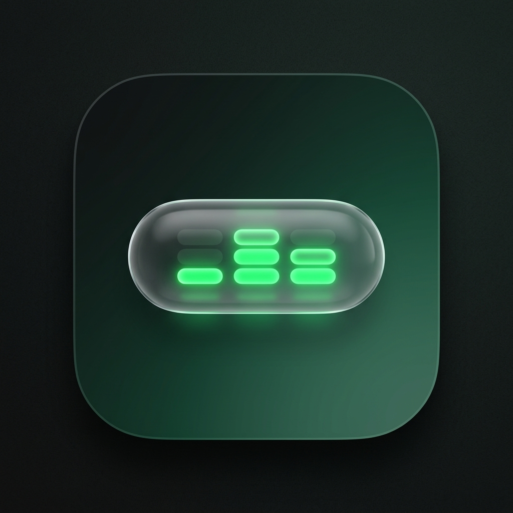
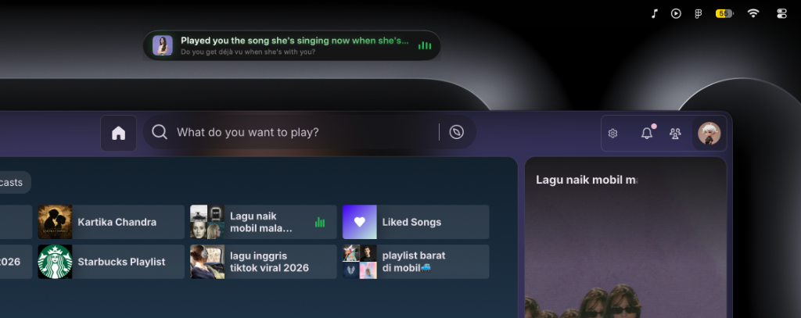
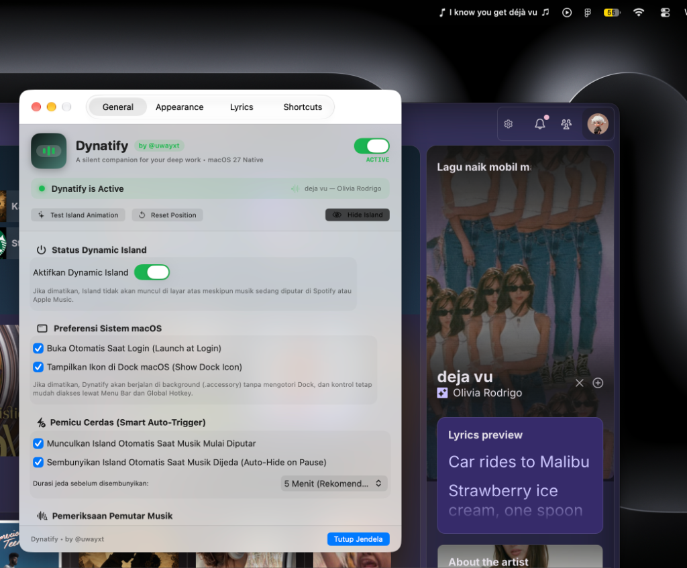
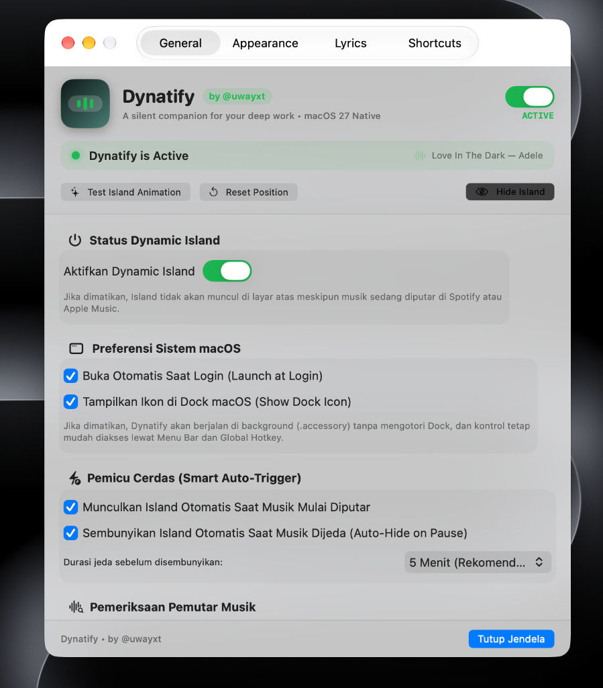
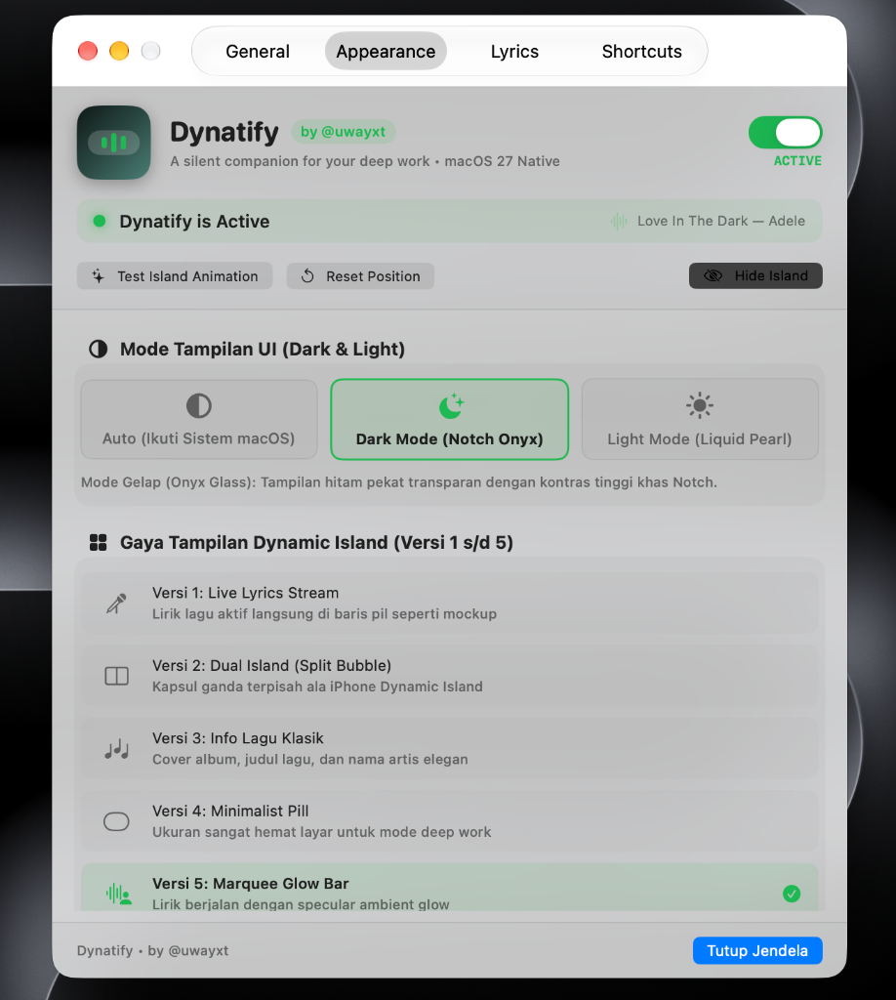
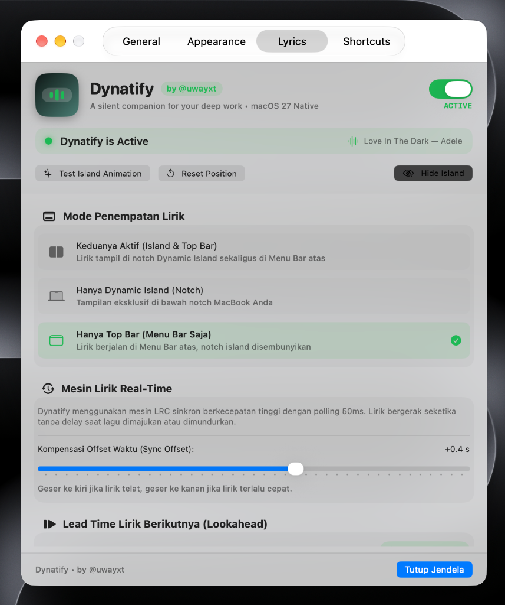

# 🏝️ Dynatify

<p align="center">
  
</p>

<p align="center">
  <strong>Dynamic Island & Real-Time Synced Lyrics for Spotify & Apple Music on macOS</strong><br>
  <em>A silent companion for your deep work • Built natively with Swift & Liquid Glass</em>
</p>

<p align="center">
  <a href="https://github.com/uwayxt/Dynatify/releases"></a>
  <a href="#"></a>
  <a href="#"></a>
  <a href="#"></a>
  <a href="#"></a>
  <a href="#"></a>
  <a href="LICENSE"></a>
  <a href="https://github.com/uwayxt"></a>
</p>

---

## 📸 Showcase: The Dynamic Island on Mac

<p align="center">
  
  <br>
  <em>Figure 1: Dynatify floating elegantly beneath the MacBook physical notch, streaming synced lyrics with dynamic live audio visualizer.</em>
</p>

<br>

<p align="center">
  
  <br>
  <em>Figure 2: Dynatify Control Center running alongside Spotify, with real-time lyric ticker streaming seamlessly in the macOS menu bar.</em>
</p>

---

## 🌟 About Dynatify

**Dynatify** brings the fluid, interactive **Dynamic Island** experience to your Mac screen. Seamlessly floating right beneath the physical MacBook notch (or top-center on non-notch displays), Dynatify delivers:

- 🎤 **Synchronized line-by-line lyrics** fetched with zero latency.
- 🌊 **Fluid polyrhythmic audio visualizer** that bounces dynamically to your music and rests quietly when paused.
- ⚡ **Deep Work Focus:** Never Alt-Tab to Spotify or Apple Music again just to check a song title or read the lyrics.
- 🌐 **Bilingual Interface:** Built-in support for **English (Default)** and **Bahasa Indonesia** with instant 1-click switching.

> **Author & Design Credit:** Conceived, engineered, and maintained by **[@uwayxt](https://github.com/uwayxt)**.

---

## 🖥️ Feature Walkthrough & Menu Architecture

### 1. Control Center Dashboard (Pillar A: General Settings)

<p align="center">
  
</p>

The **Control Center** is your central command hub (open via `⌘ ,` or through the Menu Bar). Every setting is reactive and updates in real time:

- **🌐 Language Preferences (Preferensi Bahasa):**
  - **🇺🇸 English (Default):** Worldwide / International English interface.
  - **🇮🇩 Bahasa Indonesia:** Lokalisasi bahasa Indonesia untuk kemudahan navigasi pengguna lokal.
- **⚡ Dynamic Island Master Status:**
  - One-click master toggle to enable or disable the Island on demand.
  - Quick actions to test the spring-physics morphing animation or reset positioning.
- **💻 macOS System Preferences:**
  - **Launch at Login:** Starts silently with your Mac.
  - **Show Dock Icon:** When toggled off, Dynatify runs as a lightweight, clean background accessory (`.accessory`) without cluttering your macOS Dock.
- **⏱️ Smart Auto-Trigger:**
  - **Auto-show on Play:** The Island reveals itself automatically as soon as music playback begins.
  - **Auto-hide on Pause:** Automatically dismisses the Island after a configurable pause timeout (`1 Min`, `3 Min`, `5 Min Recommended`, or `10 Min`).
- **🔍 Music Player Diagnostics:**
  - One-tap connection checker for Spotify and Apple Music with status indicators and macOS Automation permission assistance.
- **🔄 In-App Software Update:**
  - Automatic GitHub release checker with one-click update download button.

---

### 2. Appearance & Customization (Pillar A: Appearance Tab)

<p align="center">
  
</p>

Dynatify adapts seamlessly to your aesthetic preferences:

- **🌓 UI Appearance Modes:**
  - **Auto (System Sync):** Automatically syncs with macOS Dark and Light mode schedules.
  - **Dark Mode (Notch Onyx):** High-contrast deep black glass that blends imperceptibly into the MacBook notch.
  - **Light Mode (Liquid Pearl):** Translucent frosted pearl glass with crisp, ultra-readable dark typography.
- **🎨 5 Dynamic Island Styles:**
  1. **Version 1: Live Lyrics Stream** — Album artwork on the left, live lyric line in the center pill, and animated visualizer on the right.
  2. **Version 2: Dual Island (Split Bubble)** — Dual-capsule layout inspired by iPhone Dynamic Island with a detached audio bubble.
  3. **Version 3: Classic Track Info** — High-definition album artwork paired with track title and artist name.
  4. **Version 4: Minimalist Pill** — Ultra-compact footprint tailored for distraction-free coding and deep work.
  5. **Version 5: Marquee Glow Bar** — Smoothly scrolling lyrics with specular ambient edge glow.
- **🌈 Waveform Visualizer Themes:**
  - 🟢 **Spotify Emerald (`#1DB954`)**
  - 🌅 **Amber Sunset (`#FF9F0A`)**
  - 🔮 **Neon Magenta (`#BF5AF2`)**
  - ⚡ **Electric Cyan (`#64D2FF`)**
  - ⚪ **Pure White**
- **📐 Adaptive Island Width:**
  - Automatically expands and contracts to wrap the exact width of the current lyric line.
  - User-configurable maximum width limit slider (280 pt – 580 pt).
- **💧 Opacity & Liquid Glass:**
  - Adjustable frosted glass opacity (70% – 100%) with ambient background blur.

---

### 3. Synchronized Lyrics & Placement (Pillar A: Lyrics Tab)

<p align="center">
  
</p>

- **📍 3 Display Placement Modes:**
  - **Both Active (Island & Menu Bar):** Floating Dynamic Island + live lyric ticker in the macOS top bar.
  - **Dynamic Island Only:** Concentrated notch experience; your Menu Bar remains clean.
  - **Top Bar Only (Menu Bar Only):** 100% clean screen area with zero floating HUD elements; lyrics stream unobtrusively in the status bar.
- **⚡ Synchronous High-Speed LRC Engine:**
  - 50ms polling loop ensuring instant response when seeking, skipping, or scrub-forwarding tracks.
- **⏱️ Time Offset Compensation (Sync Offset):**
  - Smooth slider (`-2.0s` to `+2.0s`) to adjust songs with early or delayed lyric timestamps.
- **⏩ Next Lyric Lookahead (Lead Time):**
  - Anticipate the music: displays upcoming lyric lines **0.3s, 0.5s (Recommended), 0.8s, or 1.0s early** (with fine-tuning slider up to `2.0s`) so you are always ready for the next verse!
- **👀 Lyric Sneak Peek:**
  - Shows the upcoming line hint when hovering over the Island.

---

### 4. Magic Keyboard Triggers (Pillar C)

Navigate and command Dynatify with zero friction from your keyboard:

| Shortcut | Action | Description |
| :--- | :--- | :--- |
| **`⌥ Space`** | **The Magic Trigger** | Instantly hide or reveal the Dynamic Island without touching your mouse. |
| **`⌘ ⇧ D`** | Alternative Toggle | Toggle Island visibility from anywhere. |
| **`⌘ ⇧ E`** | Expand / Collapse | Expand Island into a full music HUD with interactive scrubber & volume slider. |
| **`Esc` / Click Outside** | Collapse to Notch | Smoothly snaps the expanded card back into the compact notch pill. |
| **`⌘ ,`** | Open Control Center | Launch the settings and preferences dashboard instantly. |

---

## 📦 Installation & Setup

### Option 1: Homebrew Cask (Recommended)

Install and manage Dynatify with [Homebrew](https://brew.sh):

```bash
# Add official tap & install cask
brew tap uwayxt/dynatify
brew install --cask dynatify
```

> [!NOTE]
> If your Homebrew version prompts to trust custom third-party taps on first install, run `brew trust uwayxt/dynatify`.

To update Dynatify in the future via Homebrew:
```bash
brew upgrade --cask dynatify
```

---

### Option 2: Automated One-Line Script

Download, compile, and install Dynatify directly into `/Applications`:

```bash
curl -fsSL https://raw.githubusercontent.com/uwayxt/Dynatify/main/install.sh | bash
```

---

### Option 3: Build from Source Code

```bash
# 1. Clone repository
git clone https://github.com/uwayxt/Dynatify.git
cd Dynatify

# 2. Run local installer
./install.sh
```

---

## 🗑️ Clean Uninstallation

Dynatify respects your system and leaves no residual files:

### Via Homebrew:
```bash
brew uninstall --cask --zap dynatify
```

### Via Uninstall Script:
```bash
./uninstall.sh
```

---

## 🔒 Privacy, Security & Zero-Secrets Guarantee

- ✅ **100% Local-First:** No telemetry, tracking, or device metrics are collected or sent to any remote server.
- ✅ **No Credentials Needed:** Dynatify **never** requests your Spotify/Apple Music password or private API tokens.
- ✅ **Native macOS Security:** Uses secure local AppleScript IPC and macOS `DistributedNotificationCenter` notifications.
- ✅ **Clean Open-Source:** Audited repository with zero hardcoded credentials, device IDs, or private developer paths.

---

## 🇮🇩 Ringkasan Bahasa Indonesia (Indonesian Overview)

Dynatify hadir dengan dukungan penuh **Bahasa Indonesia**:
1. Buka **Control Center** (`⌘ ,`).
2. Pada tab **General (Umum)**, pilih **🇮🇩 Bahasa Indonesia** di kartu *Preferensi Bahasa*.
3. Seluruh menu Control Center, status bar, pintasan, dan context menu otomatis berubah ke Bahasa Indonesia.
4. Pasang dengan mudah melalui perintah Homebrew: `brew tap uwayxt/dynatify && brew install --cask dynatify`.

---

## 🛠️ Technical Specifications

- **Architectures:** Apple Silicon (M1/M2/M3/M4) & Intel x86_64
- **Minimum OS:** macOS 14.0 (Sonoma) or newer (fully tested on macOS 15 Sequoia & macOS 27)
- **UI Framework:** SwiftUI 6.0 + AppKit Floating Panel (`NSPanel`, `NSHostingView`)
- **Lyric Source:** High-speed synchronous LRCLIB API with 50ms interpolation
- **License:** MIT Open Source License

---

## 👨‍💻 Author & Credits

Designed and engineered with ❤️ by:
- **Lead Developer & Creator:** [@uwayxt](https://github.com/uwayxt)
- **Contributions & Feedback:** Open an issue or PR at [uwayxt/Dynatify](https://github.com/uwayxt/Dynatify)!

<p align="center">
  <em>Enjoy your favorite tunes while staying in deep work flow with Dynatify! 🎧✨</em>
</p>
